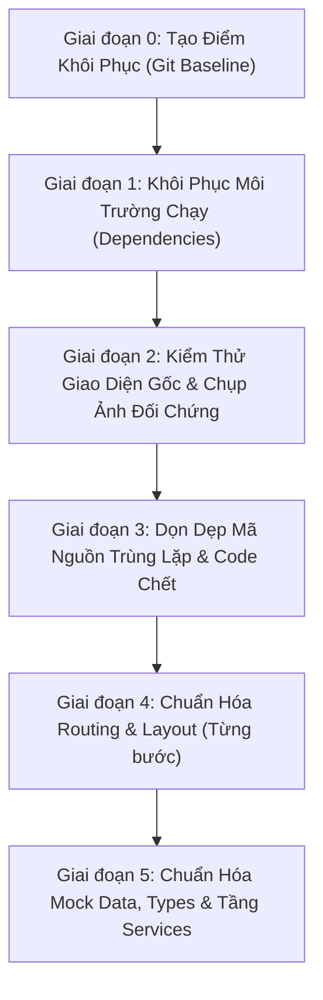

# KẾ HOẠCH CHI TIẾT TÁI CẤU TRÚC FRONTEND
**Dự án:** AI Multimodal Presentation Coach (PBL6)  
**Tài liệu tham chiếu:** [SRS v1.1](file:///c:/Users/Admin/OneDrive%20-%20The%20University%20of%20Technology/Ki_7/PBL6/TAI_LIEU_DAC_TA_YEU_CAU_SRS_v1.1.pdf) & [Đề cương kế hoạch PBL6](file:///c:/Users/Admin/OneDrive%20-%20The%20University%20of%20Technology/Ki_7/PBL6/DE_CUONG_VA_KE_HOACH_PBL6.md)  
**Vị trí mã nguồn:** [code/PBL6-ai-presentation-coach/frontend/](file:///c:/Users/Admin/OneDrive%20-%20The%20University%20of%20Technology/Ki_7/PBL6/code/PBL6-ai-presentation-coach/frontend)  
**Phiên bản kế hoạch:** 2.0 (Đã điều chỉnh theo góp ý phản biện)

---

## I. NGUYÊN TẮC BẮT BUỘC TRONG SUỐT QUÁ TRÌNH TÁI CẤU TRÚC

1. **Bảo toàn giao diện (100% UI Fidelity):**
   * Giữ nguyên thiết kế ban đầu từ Figma Make: không tự ý đổi màu sắc, typography, kích thước khoảng cách (padding/margin), biểu tượng hoặc bố cục layout.
   * Tái cấu trúc là **dọn dẹp và chuẩn hóa kiến trúc mã nguồn bên dưới**, tuyệt đối không "thiết kế lại giao diện".
2. **Làm từng bước nhỏ (Small Incremental Changes):**
   * Mỗi giai đoạn chỉ giải quyết đúng 1 bài toán duy nhất.
   * Hoàn thành xong giai đoạn nào phải kiểm tra (verify) và có điểm rollback an toàn trước khi sang giai đoạn tiếp theo.
3. **Không phỏng đoán nghiệp vụ hoặc tự chế API:**
   * Không tự suy đoán endpoint Backend hay format JSON khi Backend Lead (bạn Võ Thành Nhân) chưa công bố API contract.
   * Toàn bộ dữ liệu mẫu (mock) phải được bảo toàn nguyên vẹn trường và giá trị trong lúc dời vị trí.
4. **Phân định rõ ranh giới bảo mật:**
   * Route Guard / Auth State ở Frontend **chỉ phục vụ trải nghiệm người dùng (UX)** (ẩn/hiện menu, chuyển hướng trang hợp lý).
   * Quyền hạn thực sự và xác thực dữ liệu phải do Backend kiểm soát ở từng API endpoint qua Token/Session. Frontend tuyệt đối không lưu trữ API Key bí mật, Private Key hay logic nhạy cảm.

---

## II. LỘ TRÌNH 6 GIAI ĐOẠN CHI TIẾT



---

### GIAI ĐOẠN 0: TẠO ĐIỂM KHÔI PHỤC (RESTORE POINT)

* **Hiện trạng Git:**
  * Toàn bộ thư mục `frontend/` hiện đang ở trạng thái `Untracked` (chưa được Git theo dõi).
  * Nhánh hiện tại: `main` (đã đồng bộ với GitHub).
* **Mục tiêu:**
  * Lưu lại toàn bộ mã nguồn Figma gốc nguyên bản 100% làm điểm mốc đối chứng (baseline).
  * Tạo một nhánh riêng (`refactor/fe-clean-architecture`) để tiến hành công việc, bảo vệ tuyệt đối nhánh `main`.
* **Kế hoạch thực hiện:**
  1. Kiểm tra trạng thái: `git status`.
  2. Tạo commit ban đầu lưu nguyên bản mã nguồn Figma:
     ```bash
     git add frontend/
     git commit -m "feat(fe): lưu mã nguồn gốc khởi tạo từ Figma Make (baseline)"
     ```
  3. Tạo và chuyển sang nhánh làm việc mới:
     ```bash
     git checkout -b refactor/fe-clean-architecture
     ```
* **Lợi ích:** Có thể đối chiếu `git diff` bất cứ lúc nào với bản gốc; nếu có bất kỳ lỗi phát sinh không thể khắc phục, chỉ cần `git checkout main` là trở về nguyên trạng ban đầu.
* **Rủi ro:** Không có (vì chưa sửa bất kỳ dòng code nào).
* **Cách kiểm tra:** Chạy `git branch` hiển thị đang ở `refactor/fe-clean-architecture`, `git status` sạch sẽ (working tree clean).
* **Điều kiện Rollback:** `git checkout main` và xóa nhánh tạm nếu muốn hủy.

---

### GIAI ĐOẠN 1: KHÔI PHỤC MÔI TRƯỜNG CHẠY (RUNTIME ENVIRONMENT)

* **Hiện trạng kiểm tra:**
  * Máy tính đã có: `node v24.11.1`, `npm 11.6.2`, Git 2.49.
  * Chưa có: `pnpm` trong môi trường hệ thống.
  * Trong thư mục `frontend/` có sẵn file `pnpm-lock.yaml` (sinh ra từ môi trường Figma Make), nhưng **chưa có thư mục `node_modules`**, dẫn đến lỗi `'vite' is not recognized` khi chạy `npm run dev`.
* **Phân tích lựa chọn Package Manager (pnpm vs npm):**
  * **Lựa chọn A (Dùng pnpm - Khuyên dùng):** 
    * *Lý do:* File `pnpm-lock.yaml` đã khóa chính xác các phiên bản con tương thích tuyệt đối mà Figma Make sử dụng khi xuất code. Dùng pnpm đảm bảo 100% không phát sinh lỗi lệch version thư viện phụ.
    * *Cách cài pnpm trên máy:* Chạy `npm install -g pnpm` (rất nhanh và chuẩn).
  * **Lựa chọn B (Chuyển sang dùng npm):**
    * *Lý do:* Nếu cả nhóm PBL6 thống nhất dùng chung `npm` để không phải cài thêm tool.
    * *Yêu cầu khi chuyển:* Xóa `pnpm-lock.yaml`, chạy `npm install` để sinh `package-lock.json` chính thức cho dự án, tránh tình trạng hai lockfile tồn tại song song gây xung đột phiên bản giữa các thành viên.
* **Mục tiêu Giai đoạn 1:**
  * Cài đặt `node_modules` bằng trình quản lý gói được thống nhất.
  * Chạy thử `npm run dev` (hoặc `pnpm dev`) và `npm run build` thành công.
  * **TUYỆT ĐỐI CHƯA:** Xóa bất kỳ plugin nào trong `vite.config.ts`, chưa sửa routing, chưa di chuyển file.
* **Phân tích các plugin hiện tại trong [vite.config.ts](file:///c:/Users/Admin/OneDrive%20-%20The%20University%20of%20Technology/Ki_7/PBL6/code/PBL6-ai-presentation-coach/frontend/vite.config.ts):**
  * `figmaSiteConfiguration`: Đọc thông tin tiêu đề, meta từ `.figma/make/site.json` và tiêm vào `index.html`. *(Giữ nguyên để trang hiển thị đúng tiêu đề/meta).*
  * `figmaErrorOverlayReplay`: Hiển thị lỗi build lên màn hình preview. *(Không ảnh hưởng xấu, giữ nguyên).*
  * `figmaReactRefreshBoundaryFallback`: Hỗ trợ Hot Module Replacement. *(Giữ nguyên).*
  * `figmaMakeKitPlugin`: Quét storybook/preview. *(Giữ nguyên).*
  * *Kết luận:* Toàn bộ plugin Figma Make hiện **chưa gây lỗi gì cho bản build**, do đó **GIỮ NGUYÊN 100%** ở giai đoạn này.
* **Lợi ích:** Đưa dự án từ trạng thái "chết" sang trạng thái "chạy được" mà không thay đổi bất kỳ file cấu hình nào.
* **Rủi ro:** Xung đột phiên bản phụ thuộc giữa Node 24 và Vite 8 / Tailwind 4 nếu dùng npm giải quyết lỏng lẻo. (Xử lý bằng cách ưu tiên pnpm bám lockfile).
* **Cách kiểm tra:**
  1. Chạy lệnh dev server: Màn hình console báo server chạy thành công.
  2. Mở trình duyệt truy cập đường link hiển thị: Trang web hiển thị đầy đủ giao diện Landing Page, không có lỗi đỏ (error) trong Console DevTools.
  3. Chạy lệnh build: Lệnh build hoàn tất và sinh ra thư mục `dist/` không báo lỗi TypeScript.

---

### GIAI ĐOẠN 2: KIỂM THỬ GIAO DIỆN GỐC & CHỤP ẢNH ĐỐI CHỨNG (BASELINE AUDIT)

* **Mục tiêu:**
  * Lập hồ sơ chi tiết hiện trạng hoạt động của toàn bộ 12 trang và luồng điều hướng ban đầu.
  * Chụp ảnh màn hình (screenshot) toàn bộ các view để làm căn cứ "đối chứng trực quan" (Visual Regression Baseline).
* **Danh sách kiểm tra chi tiết từng màn hình:**

| STT | Tên màn hình / Trang | File nguồn | Tính năng đang hoạt động thật | Tính năng chỉ là Demo / Giả lập |
| :--- | :--- | :--- | :--- | :--- |
| 1 | **Landing Page** | `src/App.tsx` | Cuộn trang, hover hiệu ứng, nút mở Modal/Menu mobile | Nút "Dùng thử" chuyển view cục bộ |
| 2 | **Login Page** | `src/LoginPage.tsx` | Form nhập text, nút bấm | Đăng nhập bằng nút bấm nhanh gán role (`student`/`admin`), chưa có API |
| 3 | **Sign Up Page** | `src/SignUpPage.tsx` | Form nhập text, validate cơ bản | Nút Submit giả lập đăng ký thành công |
| 4 | **Studio Page** | `src/StudioPage.tsx` | **Thật:** Mở Webcam qua `getUserMedia`, đồng hồ đếm giờ | Nút "Kết thúc" chuyển sang trang Analyzing mà không gửi stream video |
| 5 | **Upload Page** | `src/UploadPage.tsx` | Chọn file từ máy tính, kéo thả UI | Tiến trình upload giả lập bằng timeout, chưa lưu trữ file |
| 6 | **Analyzing Page** | `src/AnalyzingPage.tsx` | Animation vòng xoay, thanh tiến trình | Đếm `setInterval` tự tăng 0-100% trong 8s rồi tự nhảy sang Report |
| 7 | **Report Page** | `src/ReportPage.tsx` | Vẽ biểu đồ Radar bằng SVG, tương tác tab checklist | Toàn bộ điểm WPM, Eye contact, Emotion là số liệu tĩnh hardcode |
| 8 | **History Page** | `src/HistoryPage.tsx` | Bảng danh sách phiên, biểu đồ tuần bằng HTML/CSS | Dữ liệu `CHART_DATA` và `SESSIONS` hardcode |
| 9 | **Settings Page** | `src/SettingsPage.tsx` | Toggle bật/tắt, ô nhập thông tin cá nhân | Bấm "Lưu" hiện toast thông báo, chưa lưu xuống Database |
| 10 | **Admin Dashboard** | `src/AdminPage.tsx` | Hiển thị đồ thị tài nguyên CPU/RAM, danh sách log | Số liệu log và server metrics giả lập |
| 11 | **Admin Users** | `src/UsersPage.tsx` | Tìm kiếm, lọc theo trạng thái, modal xác nhận Ban/Unban | Mảng `SEED_USERS` lưu trong state React, F5 sẽ reset |
| 12 | **Admin Settings** | `src/AdminSettingsPage.tsx` | Form cấu hình ngưỡng AI, toggle bảo mật | Nút lưu hiển thị trạng thái giả lập |

* **Quy trình lưu trữ ảnh đối chứng:**
  * Chụp ảnh toàn trang (Full-page screenshot) của 12 giao diện trên và lưu vào thư mục `docs/baseline-screenshots/` (hoặc kiểm tra trực quan qua browser).
* **Lợi ích:** Đảm bảo mọi bước refactor sau này đều có thước đo chính xác để đối chiếu: "Giao diện sau khi dọn code có khác 1 pixel nào so với bản gốc không?".
* **Cách kiểm tra:** Bảng ghi nhận trạng thái được hoàn thành đầy đủ, có ảnh chụp đối chứng của 12 màn hình.

---

### GIAI ĐOẠN 3: DỌN DẸP MÃ NGUỒN TRÙNG LẶP & CODE CHẾT

* **Nguyên tắc an toàn:**
  * Chỉ xóa những biến/hằng số đã được **chứng minh bằng kết quả kiểm tra mã nguồn (Grep search)** là không có bất kỳ dòng nào sử dụng.
  * Gom cụm Icon SVG theo từng nhóm nhỏ, không làm hàng loạt cùng lúc.
* **Kế hoạch cụ thể theo 2 bước nhỏ:**

#### Bước 3.1: Xóa Code Chết & Hằng Số Thừa (Dead Code Removal)
* **Bằng chứng kiểm tra đã xác thực:**
  * Mảng `NAV_ITEMS` trong [UploadPage.tsx:13-49](file:///c:/Users/Admin/OneDrive%20-%20The%20University%20of%20Technology/Ki_7/PBL6/code/PBL6-ai-presentation-coach/frontend/src/UploadPage.tsx#L13-L49), [HistoryPage.tsx:13-49](file:///c:/Users/Admin/OneDrive%20-%20The%20University%20of%20Technology/Ki_7/PBL6/code/PBL6-ai-presentation-coach/frontend/src/HistoryPage.tsx#L13-L49), [ReportPage.tsx:13-49](file:///c:/Users/Admin/OneDrive%20-%20The%20University%20of%20Technology/Ki_7/PBL6/code/PBL6-ai-presentation-coach/frontend/src/ReportPage.tsx#L13-L49): Được khai báo nhưng không hề có dòng code nào trong file gọi đến.
  * Các hàm icon thừa trong [StudioPage.tsx:13-60](file:///c:/Users/Admin/OneDrive%20-%20The%20University%20of%20Technology/Ki_7/PBL6/code/PBL6-ai-presentation-coach/frontend/src/StudioPage.tsx#L13-L60) và [AnalyzingPage.tsx:13-60](file:///c:/Users/Admin/OneDrive%20-%20The%20University%20of%20Technology/Ki_7/PBL6/code/PBL6-ai-presentation-coach/frontend/src/AnalyzingPage.tsx#L13-L60): Khai báo nhưng không dùng (vì trang đã dùng `Sidebar`).
* **Hành động:** Chỉ xóa các khối khai báo thừa này trong 5 file trên.
* **Cách kiểm tra:** Chạy `npm run build` để TypeScript xác nhận không thiếu biến; đối chiếu màn hình các trang này xem có bị mất phần tử nào không.

#### Bước 3.2: Chuẩn Hóa Icon Trùng Lặp (Icon Centralization)
* **Bằng chứng kiểm tra đã xác thực:**
  * Hàm `GeminiIcon` bị copy nguyên bản vào 10 file khác nhau.
  * Các icon điều hướng menu bị lặp lại trong `Sidebar.tsx` và `AdminPage.tsx`.
* **Hành động:**
  * Tạo thư mục `src/components/icons/index.tsx`, gom các hàm SVG này vào và `export`.
  * Thay thế lệnh khai báo trùng ở các trang bằng lệnh `import { GeminiIcon } from "@/components/icons"`.
* **Lợi ích:** Tiết kiệm hơn 400 dòng mã thừa, khi cần đổi màu hay chỉnh icon logo AI Coach chỉ cần sửa ở 1 nơi duy nhất.
* **Rủi ro:** Gõ sai tên import hoặc sai prop kích thước `size`.
* **Cách kiểm tra:** Build thành công 0 lỗi; kiểm tra logo và các icon trên thanh sidebar hiển thị sắc nét, đúng màu tím `#7C3AED`.
* **Điều kiện Rollback:** Dùng `git checkout -- <file>` để phục hồi file nếu phát hiện lỗi lệch giao diện.

---

### GIAI ĐOẠN 4: CHUẨN HÓA ROUTING & LAYOUT (TỪNG BƯỚC AN TOÀN)

* **Hiện trạng cần giải quyết:**
  * Điều hướng đang dùng `useState<View>` trong `App.tsx`: F5 bị mất trạng thái, không có URL, nút Back/Forward không chạy được.
* **Kế hoạch chuyển đổi từng bước (Không đập đi xây lại cùng lúc):**
  1. **Bước 4.1: Tách Layout dùng chung (`MainLayout` & `AdminLayout`)**
     * Hiện tại mỗi trang đều phải lặp lại:
       ```tsx
       <div className="flex h-screen bg-slate-50">
         <Sidebar userRole={...} activeItem={...} onNav={...} />
         <main className="flex-1 overflow-y-auto">...nội dung trang...</main>
       </div>
       ```
     * Tạo component layout chuẩn: bọc `Sidebar` và khung cuộn nội dung. Nội dung các trang chỉ cần tập trung vào phần thân màn hình của mình.
     * *Kiểm tra:* Giao diện và kích thước Sidebar không thay đổi dù chỉ 1 pixel.
  2. **Bước 4.2: Tích hợp `react-router-dom` song song**
     * Cài đặt `react-router-dom`.
     * Ánh xạ các `View` hiện tại thành các Route rõ ràng:
       * `/` $\rightarrow$ Landing Page
       * `/login` $\rightarrow$ Login Page
       * `/signup` $\rightarrow$ Sign Up Page
       * `/app/studio` $\rightarrow$ Studio Page (Luyện nói)
       * `/app/upload` $\rightarrow$ Upload Page (Tải video)
       * `/app/analyzing` $\rightarrow$ Analyzing Page (Chờ xử lý)
       * `/app/report/:id?` $\rightarrow$ Report Page (Xem kết quả)
       * `/app/history` $\rightarrow$ History Page (Lịch sử)
       * `/app/settings` $\rightarrow$ Settings cá nhân
       * `/admin` $\rightarrow$ Admin Dashboard
       * `/admin/users` $\rightarrow$ Quản lý người dùng
       * `/admin/settings` $\rightarrow$ Cài đặt hệ thống Admin
  3. **Bước 4.3: Chuẩn hóa Route Guards ở tầng UI**
     * Thiết lập các wrapper bảo vệ giao diện: nếu chưa đăng nhập mà gõ link `/app/studio`, tự động chuyển hướng về `/login`.
     * *Lưu ý bảo mật cốt lõi:* Ghi chú rõ trong code rằng việc chặn này chỉ để hỗ trợ UX; Backend bắt buộc phải xác thực Bearer Token ở từng API call.
* **Lợi ích:** Người dùng F5 không bị văng trang, có thể bookmark link báo cáo, nút Back trình duyệt hoạt động chuẩn chỉ.
* **Rủi ro:** Các callback `onNav(dest)` cũ trong các nút bấm bị sót link.
* **Cách kiểm tra:** Bấm thử toàn bộ các nút trên Sidebar và trong trang, bấm F5 tại từng route, bấm nút Back/Forward trên trình duyệt để kiểm tra hành vi.

---

### GIAI ĐOẠN 5: CHUẨN BỊ TÍCH HỢP BACKEND (MOCK DATA, TYPES & SERVICES)

* **Nhận thức rủi ro đúng đắn:**
  * Việc tách mock data **có rủi ro** làm sai lệch kiểu dữ liệu (Type mismatch), mất prop hoặc làm hỏng logic lọc/tìm kiếm trong UI nếu thay đổi cấu trúc dữ liệu.
* **Nguyên tắc thực hiện:**
  * **Giữ nguyên 100% hình dạng dữ liệu (Shape of Data):** Giữ đúng từng tên trường (field), kiểu dữ liệu và giá trị của các hằng số hiện có.
* **Kế hoạch cụ thể:**
  1. **Bước 5.1: Định nghĩa Typescript Interfaces (`src/types/`)**
     * Tạo `src/types/user.ts`: Định nghĩa kiểu cho User (`id`, `name`, `email`, `sessions`, `status`).
     * Tạo `src/types/presentation.ts`: Định nghĩa kiểu cho phiên nói (`id`, `title`, `date`, `duration`, `score`, `status`).
     * Tạo `src/types/report.ts`: Định nghĩa kiểu cho kết quả phân tích (`overallScore`, `radarScores`, `wpm`, `eyeContactPercent`, `transcript`, `feedbackList`).
  2. **Bước 5.2: Tách Mock Data ra khỏi file UI (`src/mocks/`)**
     * Di chuyển `SEED_USERS` từ [UsersPage.tsx](file:///c:/Users/Admin/OneDrive%20-%20The%20University%20of%20Technology/Ki_7/PBL6/code/PBL6-ai-presentation-coach/frontend/src/UsersPage.tsx) sang `src/mocks/mockUsers.ts`.
     * Di chuyển `CHART_DATA`, `SESSIONS` từ [HistoryPage.tsx](file:///c:/Users/Admin/OneDrive%20-%20The%20University%20of%20Technology/Ki_7/PBL6/code/PBL6-ai-presentation-coach/frontend/src/HistoryPage.tsx) sang `src/mocks/mockHistory.ts`.
     * Component chỉ việc import dữ liệu mẫu này vào, không định nghĩa data tĩnh ở đầu file nữa.
  3. **Bước 5.3: Xây dựng khung tầng gọi API (`src/services/`)**
     * Tạo `src/services/apiClient.ts`: Cấu hình Axios / Fetch với `baseURL` lấy từ biến môi trường `import.meta.env.VITE_API_BASE_URL` (mặc định trỏ về `http://localhost:8000/api` hoặc cổng backend do bạn Nhân quy định).
     * Tạo các service rỗng theo chuẩn interface đã thống nhất: `authService.ts`, `videoService.ts`, `reportService.ts`.
     * **TUYỆT ĐỐI KHÔNG:** Tự ý bịa đặt URL endpoint API hoặc logic xử lý khi nhóm chưa họp thống nhất API contract với Backend Lead.
* **Lợi ích:** UI trở nên tinh gọn, phân tách rạch ròi giữa Presentation Layer và Data Layer. Khi Backend sẵn sàng, chỉ cần đổi hàm gọi từ mock sang `apiClient.get(...)` là hệ thống chạy thật ngay lập tức.
* **Cách kiểm tra:**
  * Chạy `npm run build` không có lỗi Type mismatch.
  * Màn hình [UsersPage.tsx](file:///c:/Users/Admin/OneDrive%20-%20The%20University%20of%20Technology/Ki_7/PBL6/code/PBL6-ai-presentation-coach/frontend/src/UsersPage.tsx) vẫn tìm kiếm và hiển thị 10 user bình thường; chức năng lọc Active/Banned vẫn hoạt động mượt mà.
  * Màn hình [HistoryPage.tsx](file:///c:/Users/Admin/OneDrive%20-%20The%20University%20of%20Technology/Ki_7/PBL6/code/PBL6-ai-presentation-coach/frontend/src/HistoryPage.tsx) và [ReportPage.tsx](file:///c:/Users/Admin/OneDrive%20-%20The%20University%20of%20Technology/Ki_7/PBL6/code/PBL6-ai-presentation-coach/frontend/src/ReportPage.tsx) hiển thị biểu đồ và dữ liệu mẫu không sai lệch giá trị nào.

---

## III. BƯỚC ĐẦU TIÊN CẦN THỰC HIỆN NGAY

Để bắt đầu đúng quy trình an toàn nhất, **bước đầu tiên duy nhất** cần làm là:

> ### 👉 BƯỚC ĐẦU TIÊN: Thực Hiện GIAI ĐOẠN 0 (Tạo Điểm Khôi Phục Git)
> 1. Chạy lệnh lưu toàn bộ code gốc hiện tại vào Git:
>    ```bash
>    cd "c:\Users\Admin\OneDrive - The University of Technology\Ki_7\PBL6\code\PBL6-ai-presentation-coach"
>    git add frontend/
>    git commit -m "feat(fe): lưu mã nguồn gốc khởi tạo từ Figma Make (baseline)"
>    ```
> 2. Tạo một nhánh làm việc an toàn riêng:
>    ```bash
>    git checkout -b refactor/fe-clean-architecture
>    ```
> 
> *Sau khi hoàn thành bước này, mã nguồn gốc được bảo vệ an toàn 100%. Tiếp đó, bạn chỉ cần chọn muốn dùng **pnpm** hay **npm** để chúng ta tiến hành Giai đoạn 1.*
