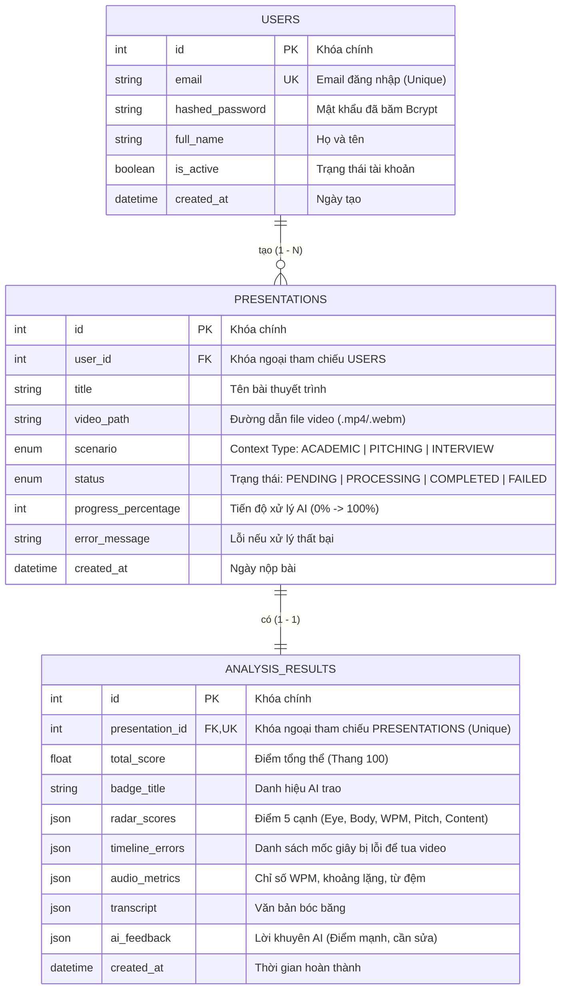

# SƠ ĐỒ CƠ SỞ DỮ LIỆU (DATABASE ERD) - PBL6

Tài liệu thiết kế Cơ sở dữ liệu và Sơ đồ thực thể quan hệ (ERD) phục vụ báo cáo **Sprint 2**.

---

## 1. Sơ đồ Thực thể Quan hệ (Mermaid ERD Diagram)

---

## 2. Chi tiết các Kiểu Dữ liệu Enum (`context_type` & `status`)

### A. Context Type / Scenario (`PresentationScenario` Enum)
Dùng để thiết lập tiêu chuẩn chấm điểm AI phù hợp với mục đích nói của người dùng:
* `ACADEMIC`: Thuyết trình Đồ án / Học thuật (Yêu cầu phong thái đĩnh đạc, tốc độ 130-150 WPM, rõ ràng).
* `PITCHING`: Pitching Khởi nghiệp / Gọi vốn (Yêu cầu năng lượng cao, nụ cười, cử chỉ tay linh hoạt).
* `INTERVIEW`: Phỏng vấn xin việc (Yêu cầu tập trung ánh mắt, điềm tĩnh, không nói lắp).

### B. Status (`PresentationStatus` Enum)
Quản lý vòng đời xử lý video async:
* `PENDING`: Đã upload file video, chờ vào hàng đợi.
* `PROCESSING`: Đang chạy AI ngầm (Cập nhật tiến độ % theo thời gian thực).
* `COMPLETED`: Đã phân tích xong, sẵn sàng xem trang Dashboard.
* `FAILED`: Xử lý thất bại (file hỏng hoặc ồn quá mức).
